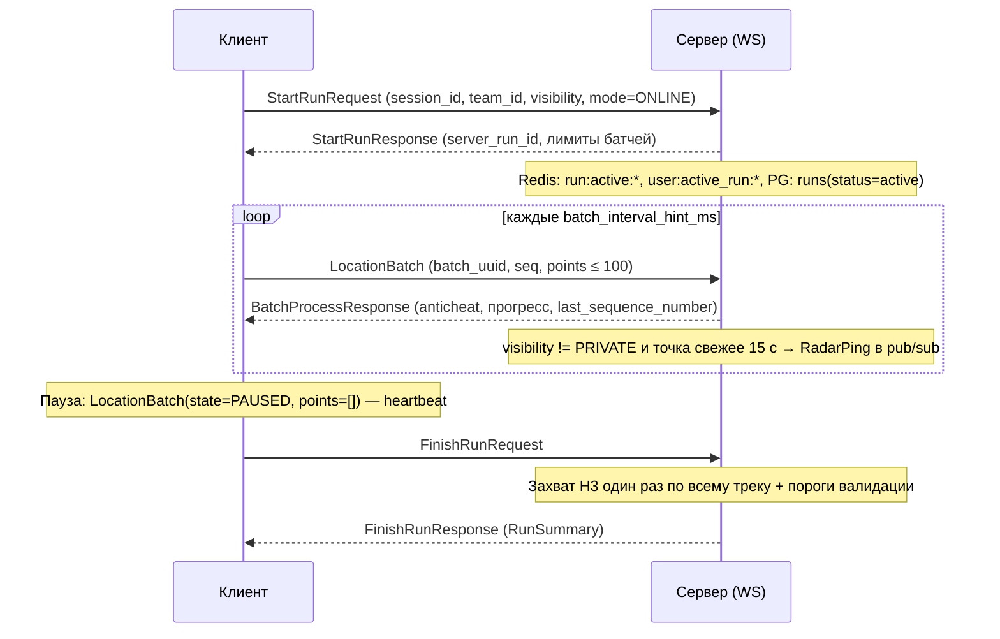
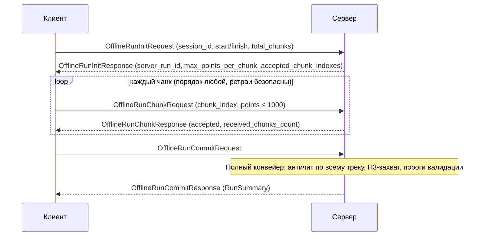

# Жизненный цикл пробежки (контракт /proto)

Документ описывает стадии пробежки и контракт Protobuf (`proto/session.proto`,
`proto/telemetry.proto`, `proto/envelope.proto`). Транспорт — WebSocket, бинарный
protobuf, мультиплексирование через `Envelope`. Чтение истории — REST (`docs/REST_API.md`),
WS-контракт покрывает запись и live-события.

Три сценария, один домен:

| Сценарий | Что происходит |
|---|---|
| **Online** | WS подключён всю пробежку: старт → поток батчей → финиш |
| **Offline → reconnect** | Старт без сети, запись локально, подключение посреди пробежки: батчи с накопленными точками доигрываются, дальше — live |
| **Offline → upload** | Пробежка целиком без сети; готовый трек загружается после финиша (Init → Chunk → Commit) |

Ключевая идея: **режим — свойство транспорта, а не домена**. `session_id` (клиентский
UUIDv4) — единый ключ идемпотентности во всех трёх сценариях.

---

## Инварианты контракта

1. **`session_id`** — идемпотентность всей пробежки. Повторный `StartRunRequest`
   с тем же `session_id` не создаёт вторую пробежку, а возвращает `resumed=true`
   и `ActiveRunSnapshot` (после падения приложения, переподключения).
2. **`batch_uuid`** — дедуп батча на ретраях (Redis `run:batch:{run_id}:{uuid}`, NX).
3. **`sequence_number`** — монотонно возрастает с 1 в рамках сессии. Сервер отвечает
   `last_sequence_number` — клиент после разрыва доигрывает батчи с номером больше него.
4. **Часы клиента недоверенные.** Каждый ответ несёт `server_timestamp_ms` для оценки
   скью; для offline-пробежек сервер пересчитывает длительность по таймштампам точек
   и сверяет с заявленными start/finish (расхождение → `VALIDATION_REASON_INVALID_TIMESTAMPS`).
5. **Батч принимается целиком или отвергается целиком** (anti-cheat — предикат над батчем).
6. Лимиты клиент получает из ответа сервера (`max_points_per_batch`,
   `batch_interval_hint_ms`, `max_points_per_chunk`), не хардкодит.

---

## Сценарий 1 — Online



Стадии:

1. **Старт** — `StartRunRequest` → `StartRunResponse`. Отказы:
   `ACTIVE_SESSION_EXISTS` (другая активная пробежка), `USER_BLOCKED`, `INVALID_FACTION`.
2. **Поток** — `LocationBatch` → `BatchProcessResponse`. Anti-cheat (пороги в
   `docs/RUN_ROLES.md` §1): точность > 30 м, скорость > 35 км/ч, телепорт > 100 м,
   немонотонные/будущие таймштампы, mock-провайдер. Отклонённый батч в трек не
   попадает; клиент продолжает стримить дальше.
3. **Пауза/сердцебиение** — `RUNNING_STATE_PAUSED` с пустым `points`; продлевает TTL
   `run:track:*` (24 ч), не двигает дистанцию.
4. **Переподключение** — см. ниже.
5. **Финиш** — `FinishRunRequest` → `RunSummary`. Захват территории считается один
   раз по всему треку (включая замыкание контура, `docs/RUN_ROLES.md` §2).
   Повторный финиш с тем же `session_id` → `ALREADY_FINISHED` + сохранённый summary.
6. **Отмена** — `CancelRunRequest`: трек сохраняется со `status=cancelled`, очки не
   начисляются.

### Восстановление связи (reconnect)

```mermaid
sequenceDiagram
    participant C as Клиент
    participant S as Сервер

    Note over C,S: WS оборвался посреди пробежки; клиент копит точки локально
    C->>S: новый WS + GetActiveRunRequest
    S-->>C: GetActiveRunResponse (snapshot: last_sequence_number, дистанция)
    Note over C: доигрывает батчи с seq > last_sequence_number
    C->>S: LocationBatch (seq = N+1 …)
    S-->>C: BatchProcessResponse
    C->>S: FinishRunRequest
    S-->>C: FinishRunResponse (RunSummary)
```

Если приложение упало и перезапустилось — тот же путь, либо `StartRunRequest` с тем
же `session_id`: ответ `resumed=true` + snapshot.

---

## Сценарий 2 — Offline → reconnect посреди пробежки

1. Клиент стартует без сети: `StartRunRequest` невозможен, точки пишутся в локальное
   хранилище, `session_id` генерируется сразу (нужен для сценария 3).
2. Сеть появилась — клиент вызывает `StartRunRequest` c `mode=RUN_MODE_OFFLINE`.
3. Клиент доигрывает накопленное обычными `LocationBatch`: у точек таймштампы в
   прошлом, но для сессии с `mode=OFFLINE` сервер не проверяет «свежесть» и не
   публикует радар для старых точек. Кинематические проверки (скорость, телепорт,
   монотонность) работают как обычно — в границах батча.
4. Дальше — обычный live-поток и финиш как в сценарии 1.

Захвату территории это не мешает: он в любом случае считается один раз на финише.

---

## Сценарий 3 — Offline → upload после финиша

Трек 12 ч при 1 Гц — до 43 200 точек (~2 МБ protobuf), поэтому загрузка
**чанками по WS**, а не одним сообщением.



Стадии:

1. **Init** — сервер создаёт `runs(status=active)` и metadata-запись для сборки.
   Идемпотентен: повторный Init с тем же `session_id` возвращает уже принятые чанки
   (`accepted_chunk_indexes`) — возобновление после обрыва или смерти приложения
   посреди загрузки. Отказы: активная пробежка, конфликт payload, кривой
   временной диапазон, слишком много точек.
2. **Chunk** — чанки в любом порядке, дедуп по `(session_id, chunk_index)`.
   `anticheat_status` в ответе — превью-совет по чанку; финальный вердикт — на Commit
   по собранному целиком треку (нужны соседние точки для сегментных проверок).
3. **Commit** — полный конвейер: античит по всему треку → разрешение захватов H3 →
   пороги валидации (`docs/RUN_ROLES.md` §3) → запись в PG. Пробежка короче 100 м /
   60 с сохраняется с `is_valid=false` + `validation_reason` (история есть, очков нет).
   Повторный Commit возвращает сохранённый summary (`ALREADY_COMMITTED`).

---

## Сообщения и номера в Envelope

| Диапазон | Стадия | Сообщения |
|---|---|---|
| 10–11 | Поток телеметрии | `LocationBatch`, `BatchProcessResponse` |
| 20–27 | Online-жизненный цикл | Start / GetActiveRun / Finish / Cancel (req+resp) |
| 30–35 | Offline-загрузка | Init / Chunk / Commit (req+resp) |
| 40–43 | Карта и радар | SubscribeViewport, HexagonCaptureEvent, RadarPing |

## Идемпотентность — сводная таблица

| Операция | Ключ | Повторный запрос |
|---|---|---|
| StartRun | `session_id` | `resumed=true` + snapshot |
| LocationBatch | `batch_uuid` | тот же OK-ack без повторного зачёта |
| OfflineRunInit | `session_id` | текущее состояние загрузки |
| OfflineRunChunk | `(session_id, chunk_index)` | ack без повторного зачёта |
| OfflineRunCommit | `session_id` | сохранённый RunSummary |
| FinishRun | `session_id` | сохранённый RunSummary (`ALREADY_FINISHED`) |

## Итоговая структура /proto

| Файл | Содержимое |
|---|---|
| `common.proto` | `SystemStatus` — транспортные коды |
| `telemetry.proto` | `LocationPoint`, `LocationBatch`, `BatchProcessResponse`, `RunningState`, `AnticheatStatus` |
| `session.proto` | жизненный цикл: Start/GetActiveRun/Finish/Cancel + Offline Init/Chunk/Commit, `RunSummary`, перечисления причин отказа |
| `gamemap.proto` | viewport, захваты гексагонов, радар |
| `envelope.proto` | мультиплексирование WS |

Устаревшие `events.proto` и `location.proto` удалены; C++ (`run_service`,
`location_mapper`, тесты) мигрирован на пакеты `run::proto::session` /
`run::proto::telemetry`.

## Сервисный слой (`service/running`, namespace `run::service::running`)

| Компонент | Зона |
|---|---|
| `TelemetryIngestor` | горячий путь: `LocationBatch` → античит → дедуп → трек → ack; PG не трогает |
| `RunSessionService` | жизненный цикл: Start (строка в PG создаётся сразу, `server_run_id`), GetActiveRun, Finish, Cancel; владеет идемпотентностью |
| `RunFinalizer` | единственный путь закрытия: античит-replay → H3-захват → пороги → PG-транзакция → cleanup Redis |
| `OfflineUploadService` | Init/Chunk/Commit; закрытие через общий `RunFinalizer` |
| `RadarPublisher` | live-пинги: видимость + окно свежести 15 с (offline-replay отфильтровывается сам) |
| `ServiceStack` / `ServiceDeps` | композиция графа; заглушки ↔ Redis/PG меняются только здесь (`MakeStubDeps`) |

Хранилища — за интерфейсами `repository/IActiveRunStore` (Redis-плоскость) и
`repository/IRunHistoryRepository` (PostgreSQL); in-memory заглушки —
`repository/in_memory_stores.hpp`. Транспорт — `network/server/envelope_dispatcher.hpp`,
единственный свитч по `Envelope.payload`.

## Персистентность (что уже реализовано)

* PostgreSQL-плоскость: `ConnectionPool` (pqxx) + `PostgresUserRepository`
  (login/профиль) + `PostgresRunHistoryRepository` (строка `runs` на старте,
  единая финализирующая транзакция: runs + run_points + hexagons +
  hexagon_history + user_stats). Подключение — из env `POSTGRES_*`
  (см. `.env` / docker-compose); если БД недоступна, композиционный корень
  (`Server`) падает back на in-memory заглушки (dev-режим).
* Redis-плоскость: `IActiveRunStore` пока in-memory; прод-реализация
  (`RedisActiveRunStore` поверх `ShardedRedisManager`) — следующий шаг.

## Что осталось на стороне сервера (вне контракта)

* `RedisActiveRunStore` — Redis-реализация live-состояния (ключи расписаны в
  комментариях `IActiveRunStore`).
* Радар: публикация `HexagonCaptureEvent` после финализации + конвертация
  res9 → res6-parent перед `BroadcastToZone`.
* Устаревший `service/run_service.{hpp,cpp}` удалить после переноса логики
  Redis-репозитория в `IActiveRunStore`.
