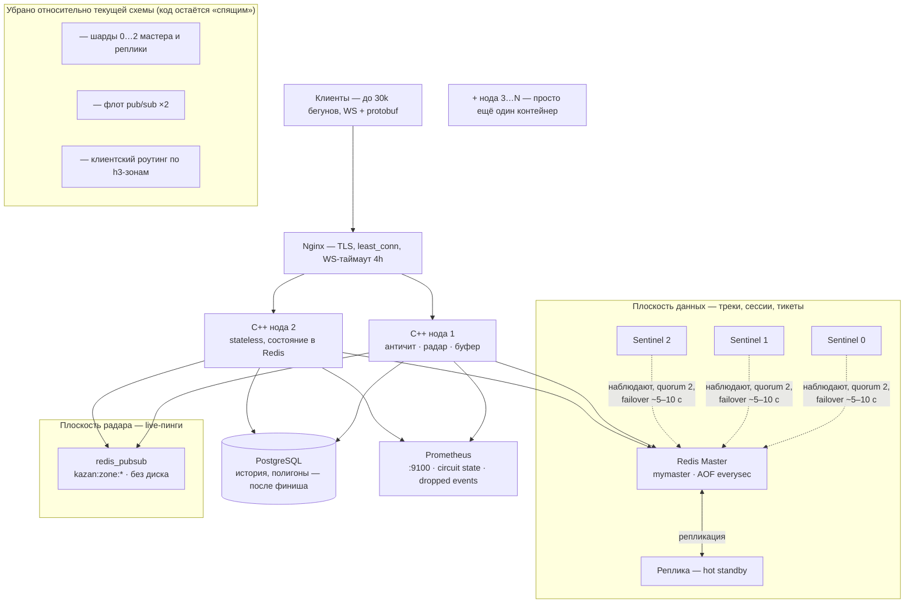

# Архитектура Redis — Вариант A (упрощённая)

Интерактивная версия схемы: [redis-option-a.html](redis-option-a.html)

## Диаграмма

## Правила работы схемы

- **Плоскость данных**: один мастер (`mymaster`) + реплика. Треки (`run:track:*`),
  сессии (`run:active:*`), маппинги (`user:active_run:*`) и WS-тикеты живут здесь.
  Падение мастера: Sentinel'ы фиксируют простой (5 c), голосуют (quorum 2),
  повышают реплику и публикуют `+switch-master`; ноды переподключаются автоматически,
  телеметрия паузы копится в in-memory буфере (circuit breaker).
- **Плоскость радара**: отдельный инстанс pub/sub без персистентности.
  Публикация пингов `kazan:zone:{hex}:radar:*` и подписка нод. Падение = потеря
  только live-пингов, телеметрия не затрагивается.
- **Capacity**: базовый режим держит ~15–20k активных бегунов (75–150k команд/с
  на один мастер с конвейеризацией).
- **Путь роста** (без переписывания приложения):
  1. `REDIS_NUM_SHARDS=3` — шардирование по `run_id` (код и тесты готовы, конфиг в env);
  2. `REDIS_PUBSUB_HOSTS=...,...` — флот радара с шардированием каналов по h3-зоне;
  3. больше C++-нод за тем же Nginx — состояние целиком в Redis/PG.

## Ключи Redis

| Ключ | Тип | Назначение | TTL |
|---|---|---|---|
| `run:track:{run_id}` | List | GPS-точки `lat,lon,speed,ts` | 24 ч (продление раз в 30 c) |
| `run:active:{run_id}` | Hash | сессия: user, team, дистанция, очки, статус, visibility | 24 ч → 1 ч после финиша |
| `run:batch:{run_id}:{uuid}` | String (NX) | дедуп ретраев батчей | 24 ч |
| `user:active_run:{user_id}` | String | user → активная сессия | 24 ч |
| `ws_ticket:{ticket}` | String | одноразовый WS-тикет | 30 c |
| `kazan:zone:{hex}:radar:*` | Pub/Sub | live-позиции бегунов | эфемерно |
