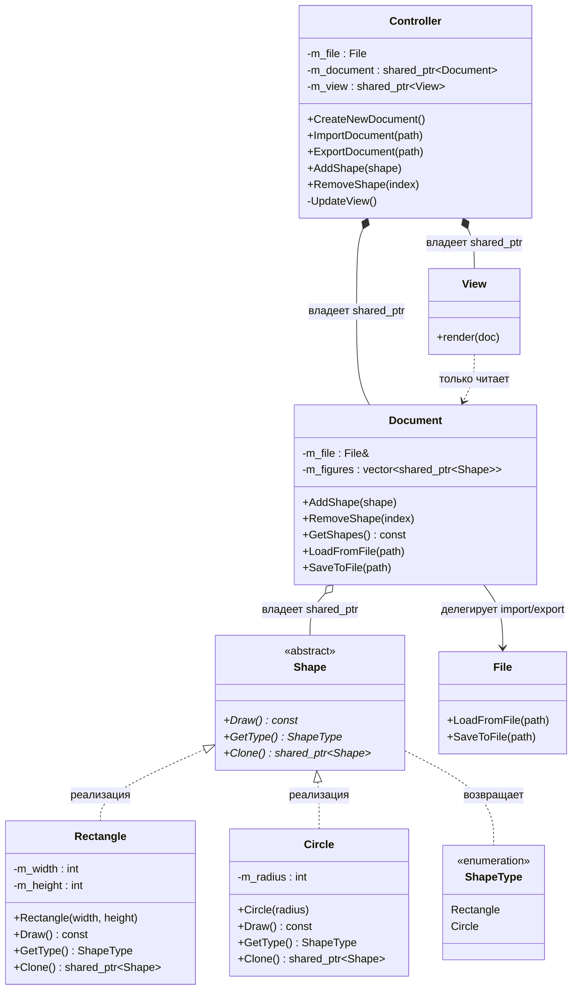
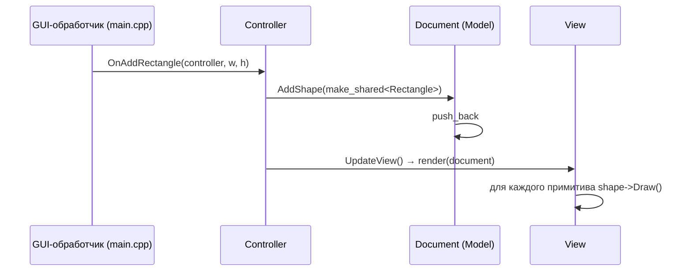

# UML-диаграммы графического редактора

- **Model** (`include/models/`) — документ и графические примитивы. Не знает ни о View, ни о Controller.
- **View** (`include/view.hpp`) — отображение документа. Знает только интерфейс модели.
- **Controller** (`include/controller.hpp`) — принимает команды от GUI и координирует Model и View.
- **GUI-обработчики** (`src/main.cpp`) — функции `gui::On*`, по одной на каждый элемент интерфейса; собираются в одном файле с `main()`.

## Диаграмма классов

Владение объектами решено умными указателями: `Controller` владеет `Document` и `View` через `std::shared_ptr`, `Document` владеет примитивами через `std::vector<std::shared_ptr<Shape>>`.

## Последовательность обработки события GUI

Аналогично устроены остальные обработчики: `OnCreateNewDocument`, `OnImportDocument`, `OnExportDocument`, `OnRemoveShape` — все сведены к вызовам `Controller` и завершаются обновлением представления.
